# Raw data statistical diagnostics and claim verification

Generated by `python scripts/44_raw_report.py all` (code: `scripts/44_raw_report.py`, `44b_raw_report_regress.py`, `44c_raw_report_render.py`, `src/wxrisk/diag.py`; tests: `tests/test_diag.py`). Do not edit by hand. Random seed 0 throughout; bootstrap over the dependent units named in each table (200 resamples for regressions, 200 permutations for cluster labels). Raw statistics come from the downloaded files; the cluster and regression sections use the inputs the models use (anomaly-scaled SCS columns, the flood pilot table, the clean claims table).

Input fingerprints (content hashes, `prep` sidecars): `policies_tx` input 5205d3f9d206 / output 576fe7cf8c16, `claims_nfip` input 9745ce3ade52 / output a8367aea9b22.

## 0. How to read this report

- **Silhouette / Hopkins / ARI / mutual information** (section 3) answer three different questions: is there structure, is it reproducible, does it matter for the outcome. A partition can fail the first and pass the third; that is a quantiser.
- **Within-event AUC** (section 4.1, 4.2) compares rows of the same episode (or year) only; 0.5 is no information and values below 0.5 are a negative association.
- **Cluster bootstrap**: rows within an episode, county, state-month or year are dependent, so intervals resample those groups, never the rows.
- A verdict of *not established* means the interval contains the null value; it is not a proof of absence, only that this sample gives no evidence.

## 1. Claims and verdicts

Every statement the project makes that a dataset *can be clustered* or *can be regressed* is listed here with the section that tests it and the verdict computed from the data.

| # | Claim | Dataset | Test (section) | Verdict |
|---|---|---|---|---|
| C1 | The SCS tier B environment can be partitioned by K-means | ERA5 county points, 13 columns | 3.1 | No natural clusters (silhouette 0.091); usable as a quantiser: labels carry out-of-sample information (p <= 0.005) |
| C2 | The SCS tier C environment can be partitioned by K-means | ERA5 county points, 28 columns | 3.2 | No natural clusters (silhouette 0.050, 8 clusters with negative silhouette); usable as a quantiser (p <= 0.005) |
| C3 | Take-up across block groups is bimodal | NFIP policies / ACS housing units | 3.3 | Bimodal (coefficient 0.594); the number of components is not identifiable |
| C4 | A Gaussian-process model | - | 3.4 | Not claimed, not applicable |
| R1 | Flood occurrence can be regressed on rain, exposure, geography, terrain | Texas flood pilot table | 4.1 | Yes: 17 cell-level and 29 episode-level features established; none for lat, lon, elev, rel1, pos3, slope... |
| R2 | SCS event occurrence can be regressed on the convective environment | ERA5 county points | 4.2 | Yes: 21 / 28 inputs established for y0, 19 for y10k |
| R3 | New NFIP purchases can be regressed on claim intensity (and economics) | Stock-flow panel, 45 counties | 4.3 | Present, not stable: concentrated in 2012-2017 (Harvey); economic covariates not stable |
| R4 | The damage ratio can be regressed on depth and building attributes | NFIP claims 2016+ | 4.4 | Yes for depth, foundation group, elevated indicator; SFHA adds nothing alone |
| R5 | Post-event-buyer share explains Harvey claim rates | Policies x claims | 4.5 | Not established (interval contains 0); not claimed |

## 2. Raw dataset verification

Statistics of the files as downloaded (claims, policies, gridMET, SCS labels) or as extracted from downloads (ERA5 at county points), before any cleaning. What each flag means for the cleaning rules is in `docs/CLEANING_REGISTER.md`.

| Dataset | Rows / shape | Period | Check against the provider or the structure | Result |
|---|---|---|---|---|
| NFIP claims (OpenFEMA v3, national) | 1,564,325 rows, 24 year files | 2000-2023 | row count vs OpenFEMA `$count` for yearOfLoss 2000-2023; `id` unique | provider 1,564,325; distinct ids 1,564,325 |
| NFIP policies, Texas (OpenFEMA v3) | 11,612,805 rows | effective 2009-2026 | row count vs OpenFEMA `$count` for propertyState TX; exact duplicate rows | provider 11,612,805; duplicate rows beyond the first: 157,230 |
| gridMET precipitation, Texas box | 8766x260x320 float32 | 2000-01-01 to 2023-12-31 | calendar gaps; negative values; NaN share | gaps 0; negative 0; NaN 27.8486% |
| SCS3 county-day labels (CO, NM, AZ) | 394,128 rows, 112 counties | 2000-05-01 to 2022-09-30 (May-Sep) | duplicate (county, day) | 0 duplicates |
| ERA5 at county points (12Z and 18Z) | 394,128 rows, 28 variables | 2000-2022 | values outside physical ranges | 0 out of range |
| Texas flood pilot table (derived) | 2,996,576 rows, 44,212 episodes | 2010-2023 | positives per year | 11,264 positives |

### 2.1 NFIP claims

- Schema drift between year files: `floodCharacteristicsIndicator` (double / null), `floodWaterDuration` (double / int64), `occupancyType` (double / int64). Types are reconciled by the cleaning step.
- Row count equals the provider's count: **True**; `id` unique: **True**.

Rows per loss year:

| 2000 | 2001 | 2002 | 2003 | 2004 | 2005 | 2006 | 2007 | 2008 | 2009 | 2010 | 2011 |
|---|---|---|---|---|---|---|---|---|---|---|---|
| 23,247 | 54,492 | 34,512 | 47,846 | 76,034 | 277,027 | 29,651 | 28,360 | 96,968 | 37,734 | 37,818 | 96,466 |

| 2012 | 2013 | 2014 | 2015 | 2016 | 2017 | 2018 | 2019 | 2020 | 2021 | 2022 | 2023 |
|---|---|---|---|---|---|---|---|---|---|---|---|
| 175,804 | 24,062 | 18,772 | 34,581 | 85,497 | 145,681 | 42,625 | 35,312 | 33,185 | 46,699 | 60,262 | 21,690 |

Column profile (null share, approximate distinct values, range, share of exact zeros):

| Column | Type | Null % | Distinct~ | Min | Median | Max | Zero % |
|---|---|---|---|---|---|---|---|
| id | BIGINT | 0.00% | 1,624,417 | 5448672 | 6811461.0 | 8174660 | 0.00% |
| state | VARCHAR | 0.00% | 55 | AK |  | WY |  |
| countyCode | VARCHAR | 0.40% | 2,837 | 01001 |  | 78030 |  |
| censusGeoid | VARCHAR | 1.12% | 97,226 | 010010201001 |  | 780309612002 |  |
| reportedZipCode | VARCHAR | 0.00% | 22,097 |  |  | 99999 |  |
| dateOfLoss | VARCHAR | 0.00% | 8,640 | 2000-01-01T00:00:00.000Z |  | 2023-12-31T00:00:00.000Z |  |
| yearOfLoss | BIGINT | 0.00% | 24 | 2000 | 2011.0 | 2023 | 0.00% |
| floodEvent | VARCHAR | 24.68% | 120 | 2021 Mid-Spring Severe S |  | Yellowstone Flooding |  |
| causeOfDamage | VARCHAR | 2.11% | 15 | 0 |  | Z |  |
| waterDepth | DOUBLE | 8.84% | 427 | -144.0 | 1.0 | 990.0 | 32.94% |
| exteriorWaterDepth | DOUBLE | 77.91% | 493 | -252.0 | 11.0 | 9600.0 | 4.98% |
| interiorWaterDepth | DOUBLE | 81.16% | 436 | -734.0 | 2.0 | 7000.0 | 6.85% |
| floodWaterDuration | DOUBLE | 11.28% | 164 | 0.0 | 0.0 | 999.0 | 87.82% |
| floodCharacteristicsIndicator | DOUBLE | 99.18% | 5 | 1.0 | 2.0 | 5.0 | 0.00% |
| amountPaidOnBuildingClaim | DOUBLE | 19.38% | 875,866 | -2250000.0 | 20195.85 | 10741476.93 | 4.44% |
| amountPaidOnContentsClaim | DOUBLE | 19.38% | 344,529 | -41276.32 | 0.0 | 757048.95 | 44.52% |
| netBuildingPaymentAmount | DOUBLE | 0.00% | 880,753 | -2250000.0 | 10841.22 | 10741476.93 | 23.90% |
| netContentsPaymentAmount | DOUBLE | 0.00% | 343,955 | -41276.32 | 0.0 | 757048.95 | 64.64% |
| buildingDamageAmount | DOUBLE | 18.69% | 192,986 | 0.0 | 21351.0 | 166406640.0 | 1.27% |
| contentsDamageAmount | DOUBLE | 57.27% | 92,451 | 0.0 | 9434.0 | 16741290.0 | 3.21% |
| ratedFloodZone | VARCHAR | 0.86% | 70 | A |  | X |  |
| occupancyType | DOUBLE | 0.00% | 13 | 1.0 | 1.0 | 19.0 | 0.00% |
| totalBuildingInsuranceCoverage | BIGINT | 0.00% | 9,514 | 0 | 200000.0 | 272500000 | 1.75% |
| nfipRatedCommunityNumber | VARCHAR | 0.00% | 14,755 | 000000 |  | 780000 |  |
| foundationType | VARCHAR | 0.00% | 7 | 0 |  | 6 |  |
| policyCount | BIGINT | 0.00% | 391 | 1 | 1.0 | 1090 | 0.00% |
| elevatedBuildingIndicator | BOOLEAN | 0.00% | 2 | None |  | None | 75.45% |
| postFIRMConstructionIndicator | BOOLEAN | 0.00% | 2 | None |  | None | 64.61% |

### 2.2 NFIP policies (Texas)

- Exact duplicate rows: **157,230** beyond the first occurrence (59,457 groups, 1.35% of the rows). The redacted file has no policy number, so identical rows can be distinct policies. By block-group size (rows in the block group): <20: 0.645% (268 of 41,529); 20-199: 1.511% (10,798 of 714,554); 200-1999: 1.932% (85,488 of 4,424,089); >=2000: 0.92% (58,826 of 6,393,373). The share is 3.0 times higher in the most affected size class than in the smallest block groups, but it is not monotone in block-group size, so this is consistent with identical redacted attributes but does not prove it. The rows are kept (no policy number to tell the cases apart); the effect on any count is at most 1.35%.
- Policy term (expiry minus effective date), p1 / p50 / p99: [365.0, 365.0, 366.0] days, i.e. the expiry is nominal; mid-term cancellations are a separate column (see the cleaning register).

Rows per effective year:

| 2009 | 2010 | 2011 | 2012 | 2013 | 2014 | 2015 | 2016 | 2017 |
|---|---|---|---|---|---|---|---|---|
| 662,656 | 655,390 | 642,325 | 631,406 | 616,013 | 592,178 | 578,201 | 602,019 | 652,668 |

| 2018 | 2019 | 2020 | 2021 | 2022 | 2023 | 2024 | 2025 | 2026 |
|---|---|---|---|---|---|---|---|---|
| 732,046 | 747,218 | 780,355 | 769,931 | 696,039 | 646,637 | 619,543 | 574,590 | 413,590 |

| Column | Type | Null % | Distinct~ | Min | Median | Max | Zero % |
|---|---|---|---|---|---|---|---|
| propertyState | VARCHAR | 0.00% | 1 | TX |  | TX |  |
| censusGeoid | VARCHAR | 0.34% | 22,198 | 081010029223 |  | 721130705022 |  |
| reportedZipCode | VARCHAR | 0.00% | 2,162 |  |  | 99999 |  |
| policyEffectiveDate | DATE | 0.00% | 6,561 | 2009-01-01 |  | 2026-12-22 |  |
| policyTerminationDate | DATE | 0.00% | 6,496 | 2010-01-01 |  | 2028-09-04 |  |
| cancellationDateOfFloodPolicy | DATE | 96.47% | 6,495 | 2009-01-01 |  | 2026-10-25 |  |
| policyCount | SMALLINT | 0.00% | 142 | 1 | 1.0 | 603 | 0.00% |
| ratedFloodZone | VARCHAR | 0.10% | 62 | A |  | X |  |
| floodZoneCurrent | VARCHAR | 28.50% | 57 | A |  | X |  |
| occupancyType | SMALLINT | 0.00% | 14 | 1 | 1.0 | 19 | 0.00% |
| totalBuildingInsuranceCoverage | INTEGER | 0.00% | 9,797 | 0 | 250000.0 | 100500000 | 2.11% |
| buildingReplacementCost | BIGINT | 6.46% | 68,954 | 0 | 200000.0 | 2100000000 | 4.62% |
| elevationDifference | INTEGER | 82.87% | 298 | -9986 | 1.0 | 994 | 2.97% |
| postFIRMConstructionIndicator | BOOLEAN | 0.00% | 2 | None |  | None | 39.65% |
| primaryResidenceIndicator | BOOLEAN | 0.00% | 2 | None |  | None | 19.55% |
| originalConstructionDate | DATE | 0.03% | 32,283 | 0001-01-01 |  | 9999-12-31 |  |
| mandatoryPurchaseFlag | BOOLEAN | 0.00% | 2 | None |  | None | 94.53% |
| policyTermIndicator | SMALLINT | 0.00% | 4 | 1 | 1.0 | 9 | 0.00% |
| foundationType | VARCHAR | 0.00% | 7 | 0 |  | 6 |  |
| numberOfFloorsInInsuredBuilding | SMALLINT | 0.13% | 6 | 1 | 1.0 | 6 | 0.00% |
| originalNBDate | DATE | 0.03% | 15,723 | 0001-01-01 |  | 2026-12-22 |  |
| rolloverTransferCode | VARCHAR | 3.37% | 6 | E |  | Z |  |
| propertyPurchaseDate | DATE | 56.53% | 16,514 | 0001-01-01 |  | 2818-02-28 |  |
| nfipRatedCommunityNumber | VARCHAR | 0.00% | 1,184 |        |  | 485527 |  |
| totalInsurancePremiumOfThePolicy | INTEGER | 0.00% | 15,811 | -2904 | 392.0 | 416392 | 0.01% |

### 2.3 gridMET daily precipitation

- 8,766 days x 260 x 320 cells, lat 25.82-36.61, lon -106.68--93.39; no calendar gap.
- NaN: 27.85% of the cells are NaN on every day and 0.0% on some days only, so the missing part is a fixed mask (the part of the rectangle that is not US land: Gulf of Mexico, Mexico). Zero precipitation: 54.46% of all cell-days.
- Maximum 706.9 mm in one cell-day; 2,316 cell-days above 300 mm, on only 38 days; 84% of them on 8 days (2015-10-23: 221, 2016-03-09: 91, 2016-05-26: 165, 2017-08-26: 351, 2017-08-27: 430, 2017-08-28: 171, 2017-08-29: 276, 2019-09-18: 237): a few days with many cells each, i.e. weather systems and not isolated spikes; 2017-08-26 to 29 is the Hurricane Harvey window of the project's HURDAT2 flags, the other dates were not cross-checked against an event catalogue. Negative values: 0.
- Wet cell-days (>= 1 mm) quantiles: median 5.4, p90 25.7, p99 65.7, p99.9 122.7 mm.

Domain-mean annual total (mm) and mean daily rain by calendar month (mm/day):

| 2000 | 2001 | 2002 | 2003 | 2004 | 2005 | 2006 | 2007 | 2008 | 2009 | 2010 | 2011 |
|---|---|---|---|---|---|---|---|---|---|---|---|
| 721.7 | 727.1 | 769.9 | 590.2 | 963.8 | 582.5 | 668.3 | 879.5 | 691.5 | 745.2 | 689.2 | 432.0 |

| 2012 | 2013 | 2014 | 2015 | 2016 | 2017 | 2018 | 2019 | 2020 | 2021 | 2022 | 2023 |
|---|---|---|---|---|---|---|---|---|---|---|---|
| 576.4 | 663.8 | 625.5 | 1075.4 | 830.3 | 817.8 | 899.7 | 794.8 | 751.9 | 780.0 | 638.4 | 687.9 |

| 1 | 2 | 3 | 4 | 5 | 6 | 7 | 8 | 9 | 10 | 11 | 12 |
|---|---|---|---|---|---|---|---|---|---|---|---|
| 1.262 | 1.361 | 1.745 | 1.9 | 2.837 | 2.614 | 2.224 | 2.248 | 2.445 | 2.414 | 1.574 | 1.432 |

### 2.4 SCS3 labels

- Rate per county-day: y0 2.321%, y10k 0.282%, y100k 0.087%, y1m 0.021%. Positives: {'y0': 9149, 'y100k': 344, 'y10k': 1112, 'y1m': 82}. Rows by state: {'AZ': 52785, 'CO': 225216, 'NM': 116127}. Months present: [5, 6, 7, 8, 9] (warm season only).

Positives per year:

| head | 2000 | 2001 | 2002 | 2003 | 2004 | 2005 | 2006 | 2007 | 2008 | 2009 | 2010 | 2011 |
|---|---|---|---|---|---|---|---|---|---|---|---|---|
| y0 | 296 | 373 | 335 | 382 | 471 | 496 | 365 | 455 | 426 | 488 | 368 | 379 |
| y10k | 29 | 40 | 42 | 36 | 29 | 54 | 41 | 47 | 56 | 68 | 55 | 65 |
| y100k | 7 | 17 | 12 | 9 | 12 | 11 | 21 | 10 | 20 | 14 | 21 | 25 |
| y1m | 2 | 10 | 5 | 2 | 5 | 1 | 6 | 2 | 9 | 4 | 6 | 3 |

| head | 2012 | 2013 | 2014 | 2015 | 2016 | 2017 | 2018 | 2019 | 2020 | 2021 | 2022 |
|---|---|---|---|---|---|---|---|---|---|---|---|
| y0 | 263 | 363 | 454 | 435 | 358 | 392 | 485 | 433 | 392 | 427 | 313 |
| y10k | 47 | 48 | 58 | 64 | 45 | 50 | 57 | 39 | 28 | 67 | 47 |
| y100k | 10 | 11 | 21 | 18 | 8 | 14 | 24 | 14 | 7 | 26 | 12 |
| y1m | 2 | 1 | 1 | 4 | 3 | 6 | 5 | 2 | 0 | 2 | 1 |

### 2.5 ERA5 at county points (raw units)

Physical range = a loose bound for the variable (CAPE 0-8000 J/kg, 2 m temperature 230-330 K, ...); 'outside' counts values beyond it.

| Variable | NaN % | Min | p01 | Median | p99 | Max | Zero % | Physical range | Outside |
|---|---|---|---|---|---|---|---|---|---|
| cape_12 | 0.0 | 0 | 0 | 0 | 1334 | 6755 | 56.32 | [0, 8000] | 0 |
| cape_18 | 0.0 | 0 | 0 | 0 | 1643 | 5188 | 51.58 | [0, 8000] | 0 |
| cin_12 | 0.0 | 0 | 0 | 0 | 852.8 | 999.9 | 87.93 | [0, 1500] | 0 |
| cin_18 | 0.0 | 0 | 0 | 0 | 854 | 1000 | 80.17 | [0, 1500] | 0 |
| d2m_12 | 0.0 | 241.8 | 260.5 | 278.8 | 291.9 | 299.2 | 0.0 | [220, 310] | 0 |
| d2m_18 | 0.0 | 246.1 | 261 | 277.9 | 291.5 | 298.2 | 0.0 | [220, 310] | 0 |
| d_cape | 0.0 | -4856 | -640.3 | 0 | 1100 | 3725 | 42.71 |  |  |
| d_d2m | 0.0 | -35.61 | -9.831 | -0.5234 | 7.207 | 26.41 | 0.0 |  |  |
| d_pw | 0.0 | -22.23 | -5.896 | 0.1311 | 5.431 | 17.7 | 0.0 |  |  |
| d_t2m | 0.0 | -9.009 | 1.332 | 11.42 | 18.59 | 23.45 | 0.0 |  |  |
| dd_12 | 0.0 | -0.002686 | 0.0979 | 5.679 | 27.32 | 50.24 | 0.03 | [-0.5, 60] | 0 |
| dd_18 | 0.0 | -0.001709 | 2.58 | 18.86 | 38.93 | 57.08 | 0.0 | [-0.5, 60] | 0 |
| lapse75_12 | 0.0 | 1.075 | 11.81 | 19.3 | 25.15 | 27.89 | 0.0 | [-5, 35] | 0 |
| lapse75_18 | 0.0 | -0.707 | 12.36 | 19.94 | 25.99 | 28.53 | 0.0 | [-5, 35] | 0 |
| msl_12 | 0.0 | 9.865e+04 | 1.002e+05 | 1.015e+05 | 1.027e+05 | 1.048e+05 | 0.0 | [90000.0, 110000.0] | 0 |
| msl_18 | 0.0 | 9.814e+04 | 1.001e+05 | 1.014e+05 | 1.025e+05 | 1.042e+05 | 0.0 | [90000.0, 110000.0] | 0 |
| pw_12 | 0.0 | 0.8166 | 3.114 | 13.71 | 38.2 | 61.18 | 0.0 | [0, 80] | 0 |
| pw_18 | 0.0 | 1.025 | 3.37 | 13.74 | 38.29 | 60.55 | 0.0 | [0, 80] | 0 |
| q850_12 | 0.0 | 0.0003047 | 0.001697 | 0.006792 | 0.01394 | 0.01902 | 0.0 | [0, 0.03] | 0 |
| q850_18 | 0.0 | 0.0003341 | 0.001496 | 0.005785 | 0.01345 | 0.01783 | 0.0 | [0, 0.03] | 0 |
| shear_12 | 0.0 | 0.00431 | 0.9768 | 9.062 | 29.9 | 48.74 | 0.0 | [0, 80] | 0 |
| shear_18 | 0.0 | 0.01505 | 0.8496 | 7.978 | 27.84 | 51.34 | 0.0 | [0, 80] | 0 |
| t2m_12 | 0.0 | 256.1 | 269.2 | 286.2 | 301.9 | 310.4 | 0.0 | [230, 330] | 0 |
| t2m_18 | 0.0 | 264.4 | 277.7 | 297.6 | 310.5 | 317.6 | 0.0 | [230, 330] | 0 |
| tp_am | 0.0 | 0 | 0 | 0 | 5.241 | 61.99 | 77.27 |  |  |
| tp_pm | 0.0 | 0 | 0 | 0 | 3.985 | 67.38 | 51.03 |  |  |
| w700_12 | 0.0 | 0.01645 | 0.4198 | 5.037 | 18 | 38.19 | 0.0 | [0, 100] | 0 |
| w700_18 | 0.0 | 0.008069 | 0.5185 | 4.515 | 15.97 | 33.4 | 0.0 | [0, 100] | 0 |

### 2.6 Texas flood pilot table

| Year | Rows | Episodes | Positives | Positives per 100k rows |
|---|---|---|---|---|
| 2010 | 174,061 | 2,933 | 444 | 255.1 |
| 2011 | 94,723 | 1,158 | 81 | 85.5 |
| 2012 | 159,369 | 2,094 | 829 | 520.2 |
| 2013 | 164,163 | 2,129 | 562 | 342.3 |
| 2014 | 195,797 | 2,776 | 505 | 257.9 |
| 2015 | 255,956 | 3,972 | 2,964 | 1158.0 |
| 2016 | 256,702 | 4,187 | 2,168 | 844.6 |
| 2017 | 248,148 | 3,565 | 473 | 190.6 |
| 2018 | 268,151 | 4,042 | 855 | 318.9 |
| 2019 | 230,705 | 3,506 | 747 | 323.8 |
| 2020 | 226,937 | 3,249 | 223 | 98.3 |
| 2021 | 268,657 | 3,910 | 819 | 304.8 |
| 2022 | 237,314 | 3,309 | 319 | 134.4 |
| 2023 | 215,893 | 3,382 | 275 | 127.4 |

The positive rate per 100k rows differs by more than an order of magnitude between years (claim counts swing from under 500 to about 10,000 a year): absolute probabilities do not transfer across years, which is why the project reports within-event rankings.

### 2.7 Data lock

- 1,261 locked files: 1,260 match in size, 0 missing, 1 differ ([['labels_extra/flood/pilot/flood_pilot_test_preds.npz', 'size 77156965 != locked 25968066']]). size check only; the content-hash check is `python scripts/32_data_lock.py verify`.

## 3. Clustering claims: K-means diagnostics and projections

**What is claimed.** Stage 2 of `RESULTS.md` partitions the SCS county-day environment with K-means and reads event rates off the cells; stage 10 describes the take-up rate as bimodal. Nothing else is clustered. A claim 'the data can be clustered' is tested at three levels: (1) is there cluster structure (silhouette, Davies-Bouldin, Calinski-Harabasz, Hopkins against cluster-free references, elbow, null with permuted columns); (2) is the partition reproducible (adjusted Rand index across seeds and halves); (3) do the labels carry information about the outcome out of sample (mutual information with a permutation null). Silhouette reading (Kaufman and Rousseeuw): above 0.7 strong, 0.5-0.7 reasonable, 0.25-0.5 weak, below 0.25 no substantial structure. Projection: PCA (deterministic, and its explained variance is reported); t-SNE and UMAP distort distances and can display a separation that the original distances do not support.

Tier A (calendar and location only) is a spatial-seasonal grid and is not analysed.

### 3.1 SCS tier B (morning environment, T-3 days to T-3 h)

K-means on the anomaly-scaled inputs the model sees (13 columns, 291,312 fit rows 2000-2016, 102,816 test rows 2017-2022), K = 32 (the K the project chose by validation).

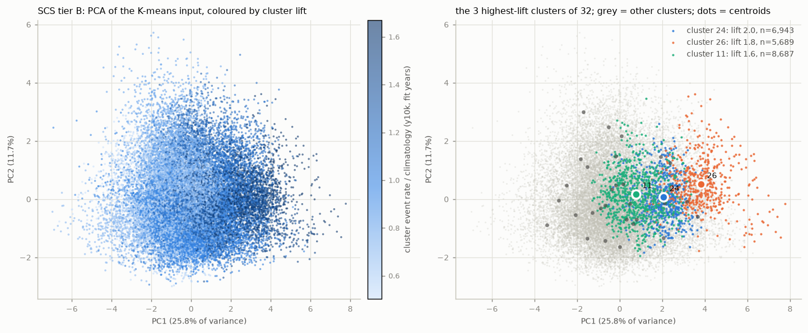

PCA of the K-means input: the first two components carry 37.6% of the variance (25.8%, 11.7%, 11.5%, 11.2%, 10.0% for the first five); the effective dimension (participation ratio) is 6.8. A 2-D picture therefore shows a minority of the structure; read it for overlap, not for separation. Left: points coloured by the event lift of their cluster. Right: the three highest-lift clusters over the rest in grey, with all centroids.

| Diagnostic | Value | Reading |
|---|---|---|
| Mean silhouette at K | 0.091 | no substantial structure |
| Silhouette of the column-permuted null at K | 0.049 | same marginals, no joint structure |
| Best K by silhouette (data) | 2 (0.145; null 0.065) | the maximum sits at the smallest K tried |
| Clusters with negative mean silhouette | 0 of 32 | points on average closer to another cluster |
| Davies-Bouldin (lower is better) | 1.95 | above 1 means clusters overlap |
| Calinski-Harabasz | 938 | only comparable across K for the same data |
| Hopkins vs uniform box (1000 test points, all fit rows) | 0.896 | any non-uniform cloud scores high |
| Hopkins: data / Gaussian same covariance / columns permuted (60k-row subsample, mean of 5 seeds) | 0.858 / 0.795 / 0.776 | the data exceed the cluster-free references by 0.063 |
| Stability: ARI, other seed / other half of the rows | 0.53 / 0.51 | 1 = identical partition |
| Cluster sizes min / median / max | 4,506 / 8,170 / 18,760 | no degenerate cluster |

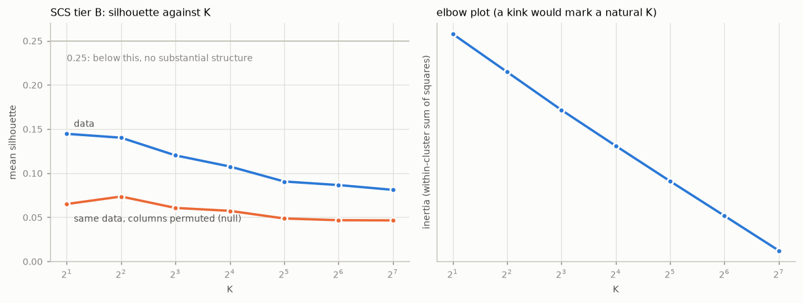

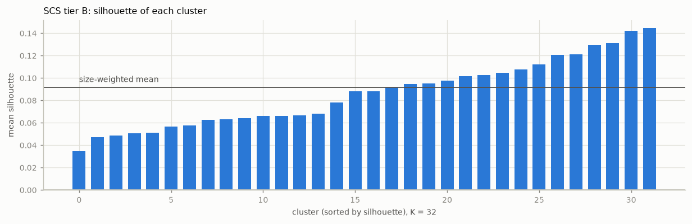

Do the cluster labels carry information about the events, out of sample? (labels from the 2000-2016 fit, tested on 2017-2022; permutation null with 200 shuffles; p = 0.005 is the floor of a 200-permutation test, 1/201: no permutation reached the observed value):

| Head | Test positives | Mutual information (nats) | Null 95th pct | Permutation p | Eta squared of cluster mean | Spearman of cluster event rate, fit vs test |
|---|---|---|---|---|---|---|
| y0 | 2442 | 0.01155 | 0.00022 | 0.005 | 0.0294 | 0.92 |
| y100k | 97 | 0.00136 | 0.00024 | 0.005 | 0.0056 | 0.65 |
| y10k | 288 | 0.00388 | 0.00023 | 0.005 | 0.0186 | 0.87 |

**Verdict.** The inputs do **not form natural clusters** (silhouette 0.091, no substantial structure; the structure is only +0.042 above the permuted null; the partition changes between fits, ARI about 0.51). K-means is therefore used as a **vector quantiser**, not as a discovery of groups: the 32 cells are justified by the out-of-sample information they carry (permutation p <= 0.005 for every head, cluster event rates agree between fit and test with Spearman 0.65-0.92), while the variance of the labels they explain is small (eta squared 0.006-0.029).

### 3.2 SCS tier C (adds the afternoon analysis and the 6-hour changes)

K-means on the anomaly-scaled inputs the model sees (28 columns, 291,312 fit rows 2000-2016, 102,816 test rows 2017-2022), K = 64 (the K the project chose by validation).

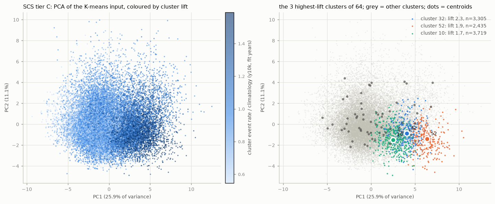

PCA of the K-means input: the first two components carry 37.0% of the variance (25.9%, 11.1%, 8.7%, 6.9%, 5.4% for the first five); the effective dimension (participation ratio) is 6.0. A 2-D picture therefore shows a minority of the structure; read it for overlap, not for separation. Left: points coloured by the event lift of their cluster. Right: the three highest-lift clusters over the rest in grey, with all centroids.

| Diagnostic | Value | Reading |
|---|---|---|
| Mean silhouette at K | 0.050 | no substantial structure |
| Silhouette of the column-permuted null at K | 0.015 | same marginals, no joint structure |
| Best K by silhouette (data) | 2 (0.177; null 0.058) | the maximum sits at the smallest K tried |
| Clusters with negative mean silhouette | 8 of 64 | points on average closer to another cluster |
| Davies-Bouldin (lower is better) | 2.20 | above 1 means clusters overlap |
| Calinski-Harabasz | 418 | only comparable across K for the same data |
| Hopkins vs uniform box (1000 test points, all fit rows) | 0.913 | any non-uniform cloud scores high |
| Hopkins: data / Gaussian same covariance / columns permuted (60k-row subsample, mean of 5 seeds) | 0.882 / 0.773 / 0.806 | the data exceed the cluster-free references by 0.076 |
| Stability: ARI, other seed / other half of the rows | 0.58 / 0.49 | 1 = identical partition |
| Cluster sizes min / median / max | 1,100 / 4,280 / 9,720 | no degenerate cluster |

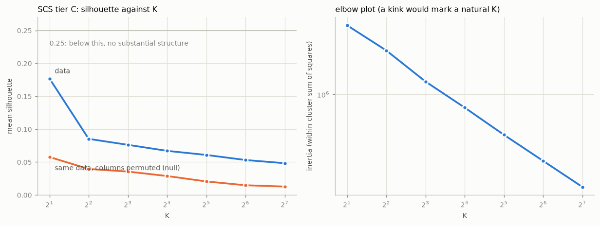

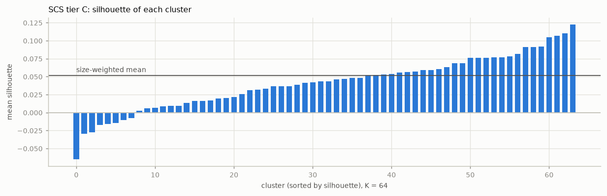

Do the cluster labels carry information about the events, out of sample? (labels from the 2000-2016 fit, tested on 2017-2022; permutation null with 200 shuffles; p = 0.005 is the floor of a 200-permutation test, 1/201: no permutation reached the observed value):

| Head | Test positives | Mutual information (nats) | Null 95th pct | Permutation p | Eta squared of cluster mean | Spearman of cluster event rate, fit vs test |
|---|---|---|---|---|---|---|
| y0 | 2442 | 0.01617 | 0.00042 | 0.005 | 0.0473 | 0.91 |
| y100k | 97 | 0.00141 | 0.00044 | 0.005 | 0.0055 | 0.65 |
| y10k | 288 | 0.00380 | 0.00043 | 0.005 | 0.0169 | 0.80 |

**Verdict.** The inputs do **not form natural clusters** (silhouette 0.050, no substantial structure; the structure is only +0.036 above the permuted null; the partition changes between fits, ARI about 0.49). K-means is therefore used as a **vector quantiser**, not as a discovery of groups: the 64 cells are justified by the out-of-sample information they carry (permutation p <= 0.005 for every head, cluster event rates agree between fit and test with Spearman 0.65-0.91), while the variance of the labels they explain is small (eta squared 0.006-0.047).

### 3.3 Take-up rate across block groups (one-dimensional mixture)

7,184 block groups (single-family non-SFHA policies per housing unit, ACS 2022; at least 200 housing units, under 5% SFHA policies), log10 scale.

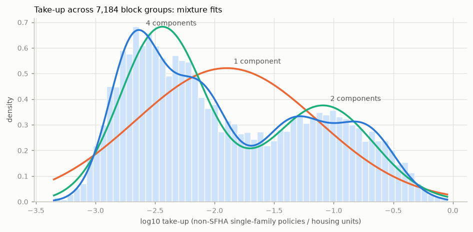

| Components | BIC | Means (log10) | Weights | SD (log10) |
|---|---|---|---|---|
| 1 | 16573.7 | [-1.899] | [1.0] | [0.766] |
| 2 | 14647.0 | [-2.442, -1.089] | [0.599, 0.401] | [0.351, 0.427] |
| 3 | 14507.4 | [-2.612, -1.979, -0.972] | [0.402, 0.266, 0.332] | [0.25, 0.319, 0.359] |
| 4 | 14480.6 | [-2.671, -1.337, -2.134, -0.735] | [0.34, 0.21, 0.27, 0.179] | [0.218, 0.271, 0.245, 0.258] |

| Diagnostic | Value | Reading |
|---|---|---|
| Bimodality coefficient (Sarle) | 0.594 | above 0.555 suggests more than one mode |
| 1-D K-means silhouette, K = 2 / 3 / 4 | 0.67 / 0.58 / 0.56 | reference: the same split of a single-mode Gaussian scores 0.56 / 0.52 / 0.52, so the silhouette alone is weak evidence in 1-D; the bimodality coefficient and the BIC carry the claim |
| BIC steps 1 to 2 / 2 to 3 / 3 to 4 | -1927 / -140 / -27 | the gain shrinks but never stops |

**Verdict.** Take-up is **bimodal** (coefficient 0.594 > 0.555; two components cut the BIC by 1927 against one). The **number** of components is not identifiable: BIC keeps falling at 4 components, as expected for a skewed, non-Gaussian density. The claim that survives is 'two regimes (take-up near 0.4% and 8.1% in the two-component fit)', not 'three owner types'. The earlier statement of stage 10 (3 components) is one point on a flat curve. The attribution to geography and flood experience is in `RESULTS.md`; this report does not test it.

### 3.4 Gaussian-process models

**Not applicable: no Gaussian-process model is claimed or used in this project.** If one is introduced, the entry conditions are the covariate report of section 4 for its inputs, plus marginal-likelihood and length-scale diagnostics (are the length scales larger than the sampling distance, is the noise term identifiable), a calibration check of the predictive intervals out of sample, and a comparison with the K-means quantiser on the same split.

## 4. Regression claims: covariate reports

**What is claimed.** The project regresses four things: flood occurrence on rain, exposure and terrain (stage 8, logistic regression and boosting); SCS event occurrence on the convective environment (stages 2-5); new NFIP purchases on claim intensity and economic covariates (stage 10 stock-flow, Poisson); the damage ratio on water depth and building attributes (stages 9-10). For each, this section reports the covariate statistics that decide whether there is data to regress on: the association of every candidate feature with the target (with a cluster-bootstrap interval, in the fit and the test period separately), the correlation structure among the candidates (correlation matrix, variance inflation factors, condition number), and the sample size (events per variable). The rules are in the header of `scripts/44b_raw_report_regress.py`: **established** needs the 95% interval to exclude the null value in the full sample and in both periods, on the same side. For binary outcomes the statistic is the within-group AUC (the project's within-event metric; effect size small / medium / large at 0.556 / 0.638 / 0.714); the pilot table also lists the within-episode Spearman correlation, which is bounded by the rarity of the event (about 1.3% of the rows in the episodes used), so its size labels would mislead. For continuous outcomes the statistic is the Spearman correlation.

### 4.1 Texas flood pilot: occurrence on rain, exposure, geography, terrain

2,996,576 block-group x episode rows, 44,212 episodes, of which 2,314 contain both outcomes and at least 10 block groups and define the within-event statistics (872,326 rows). Positives: 7,553 in the fit years, 3,711 in the test years; 34 candidate features, so **222 events per variable** in the fit years (the usual floor is 10).

Within-event AUC compares block groups of the same episode only, so county-level features (constant inside an episode) have no within-event statistic; for them, and for every feature as a level effect, the between-episode column correlates the episode mean of the feature with the episode claim rate (clusters: counties).

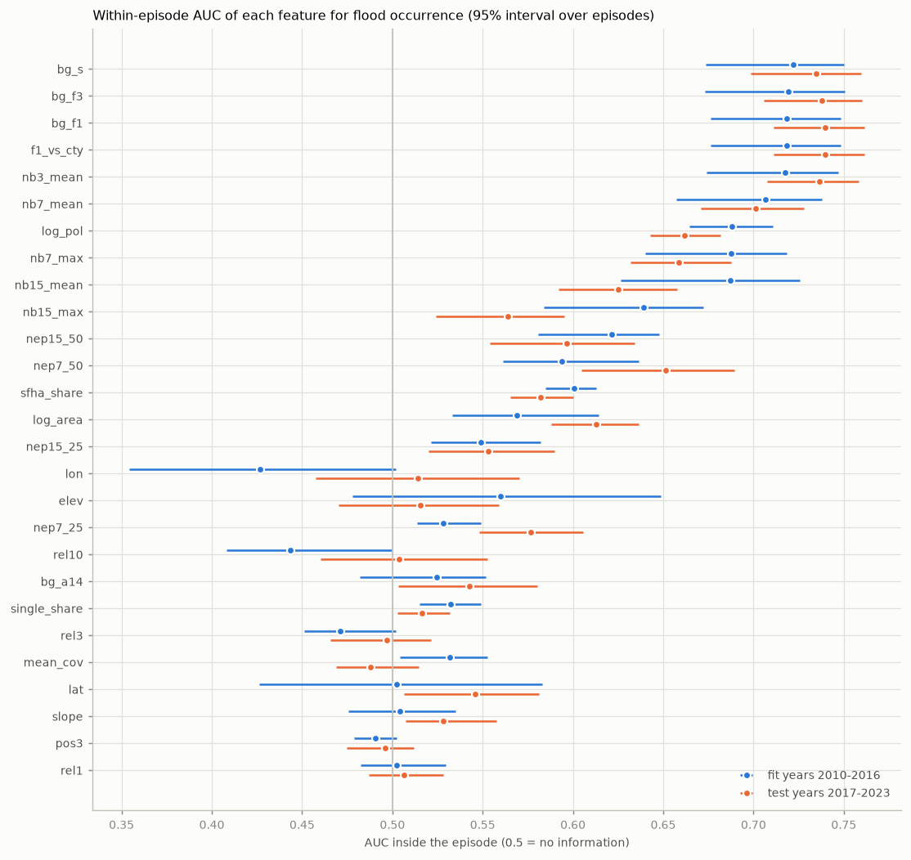

| Feature | Role | Within-event AUC, all years [95% CI] | Fit / test | Size | Within rho | Verdict (within) | Between-episode rho [95% CI] | Verdict (between) |
|---|---|---|---|---|---|---|---|---|
| `cty_f1_max` | county rain / calendar | constant in an episode |  |  |  | n/a | +0.230 [+0.214, +0.249] | established |
| `cty_f1_mean` | county rain / calendar | constant in an episode |  |  |  | n/a | +0.214 [+0.190, +0.236] | established |
| `cty_s_mean` | county rain / calendar | constant in an episode |  |  |  | n/a | +0.222 [+0.201, +0.244] | established |
| `cty_a14_mean` | county rain / calendar | constant in an episode |  |  |  | n/a | +0.087 [+0.077, +0.097] | established |
| `dur` | county rain / calendar | constant in an episode |  |  |  | n/a | +0.179 [+0.159, +0.198] | established |
| `month` | county rain / calendar | constant in an episode |  |  |  | n/a | -0.039 [-0.047, -0.031] | established |
| `cty_nbg` | county rain / calendar | constant in an episode |  |  |  | n/a | +0.246 [+0.199, +0.294] | established |
| `log_pol` | exposure | +0.680 [+0.660, +0.698] | 0.688 / 0.662 | medium | +0.065 | established | +0.168 [+0.118, +0.219] | established |
| `sfha_share` | exposure | +0.595 [+0.584, +0.605] | 0.601 / 0.582 | small | +0.029 | established | -0.113 [-0.155, -0.071] | established |
| `single_share` | exposure | +0.527 [+0.515, +0.541] | 0.532 / 0.517 | negligible | +0.002 | established | -0.004 [-0.037, +0.029] | not established |
| `mean_cov` | exposure | +0.518 [+0.500, +0.537] | 0.532 / 0.488 | negligible | +0.003 | present, not stable | +0.142 [+0.085, +0.202] | established |
| `bg_f1` | cell rain | +0.725 [+0.698, +0.749] | 0.718 / 0.740 | large | +0.068 | established | +0.224 [+0.201, +0.247] | established |
| `bg_f3` | cell rain | +0.725 [+0.699, +0.747] | 0.719 / 0.738 | large | +0.069 | established | +0.232 [+0.210, +0.256] | established |
| `bg_s` | cell rain | +0.726 [+0.704, +0.747] | 0.722 / 0.735 | large | +0.069 | established | +0.233 [+0.211, +0.256] | established |
| `f1_vs_cty` | cell rain | +0.725 [+0.698, +0.749] | 0.718 / 0.740 | large | +0.068 | established | +0.085 [+0.072, +0.100] | established |
| `nb3_mean` | neighbourhood rain | +0.723 [+0.697, +0.747] | 0.718 / 0.737 | large | +0.068 | established | +0.224 [+0.201, +0.247] | established |
| `nb7_mean` | neighbourhood rain | +0.705 [+0.678, +0.731] | 0.707 / 0.701 | medium | +0.061 | established | +0.221 [+0.197, +0.244] | established |
| `nb15_mean` | neighbourhood rain | +0.668 [+0.637, +0.699] | 0.687 / 0.625 | medium | +0.045 | established | +0.211 [+0.187, +0.234] | established |
| `nb7_max` | neighbourhood rain | +0.679 [+0.654, +0.704] | 0.687 / 0.659 | medium | +0.052 | established | +0.235 [+0.215, +0.257] | established |
| `nb15_max` | neighbourhood rain | +0.616 [+0.579, +0.647] | 0.639 / 0.564 | small | +0.034 | established | +0.224 [+0.204, +0.244] | established |
| `nep7_25` | neighbourhood rain | +0.543 [+0.530, +0.565] | 0.528 / 0.577 | negligible | +0.021 | established | +0.174 [+0.153, +0.194] | established |
| `nep7_50` | neighbourhood rain | +0.612 [+0.585, +0.650] | 0.594 / 0.651 | small | +0.047 | established | +0.242 [+0.224, +0.261] | established |
| `nep15_25` | neighbourhood rain | +0.550 [+0.530, +0.578] | 0.549 / 0.553 | negligible | +0.018 | established | +0.173 [+0.152, +0.194] | established |
| `nep15_50` | neighbourhood rain | +0.614 [+0.590, +0.638] | 0.622 / 0.597 | small | +0.037 | established | +0.224 [+0.205, +0.244] | established |
| `lat` | location / static | +0.516 [+0.463, +0.565] | 0.502 / 0.546 | negligible | -0.002 | not established | -0.088 [-0.140, -0.041] | established |
| `lon` | location / static | +0.453 [+0.406, +0.506] | 0.426 / 0.514 | negligible | -0.007 | not established | +0.072 [+0.024, +0.111] | established |
| `log_area` | location / static | +0.582 [+0.553, +0.610] | 0.569 / 0.613 | small | +0.024 | established | -0.199 [-0.249, -0.144] | established |
| `bg_a14` | location / static | +0.530 [+0.507, +0.554] | 0.524 / 0.542 | negligible | +0.007 | present, not stable | +0.088 [+0.077, +0.099] | established |
| `elev` | terrain | +0.546 [+0.492, +0.606] | 0.560 / 0.515 | negligible | -0.001 | not established | -0.113 [-0.169, -0.054] | established |
| `rel1` | terrain | +0.503 [+0.489, +0.520] | 0.502 / 0.506 | negligible | -0.002 | not established | -0.065 [-0.123, +0.001] | not established |
| `rel3` | terrain | +0.479 [+0.462, +0.497] | 0.471 / 0.497 | negligible | -0.007 | present, not stable | -0.043 [-0.104, +0.018] | not established |
| `pos3` | terrain | +0.492 [+0.483, +0.502] | 0.490 / 0.496 | negligible | -0.007 | not established | +0.022 [-0.012, +0.059] | not established |
| `rel10` | terrain | +0.462 [+0.428, +0.496] | 0.444 / 0.503 | negligible | -0.007 | present, not stable | +0.001 [-0.040, +0.043] | not established |
| `slope` | terrain | +0.512 [+0.491, +0.532] | 0.504 / 0.528 | negligible | +0.003 | not established | -0.066 [-0.120, -0.001] | established |

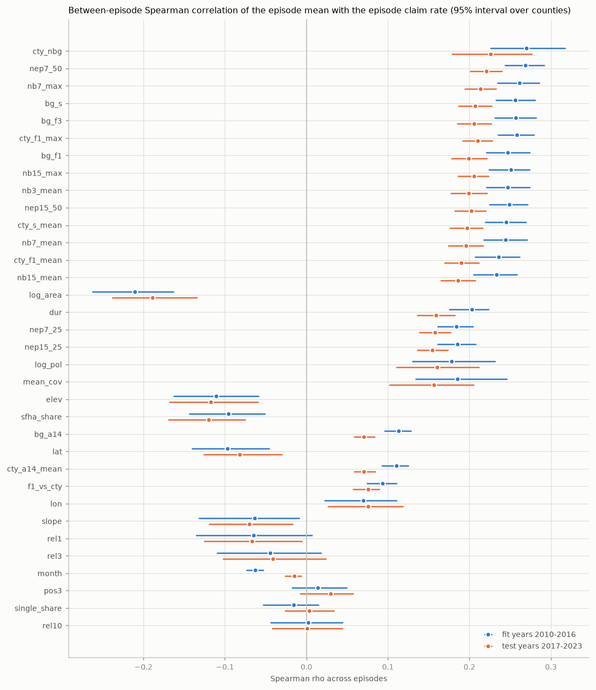

Collinearity of the plan-transformed features (fit years, 300,000 rows): condition number 64.9. Pairs with |r| >= 0.9: `bg_f1`-`nb3_mean` (+0.99), `bg_f3`-`bg_s` (+0.99), `nb3_mean`-`nb7_mean` (+0.98), `nep7_50`-`nep15_50` (+0.96), `nb7_mean`-`nb15_mean` (+0.96), `bg_f1`-`bg_s` (+0.96), `bg_f1`-`nb7_mean` (+0.96), `cty_a14_mean`-`bg_a14` (+0.96), `bg_s`-`nb3_mean` (+0.95), `cty_f1_mean`-`cty_s_mean` (+0.95), `bg_f1`-`bg_f3` (+0.95), `nep7_25`-`nep15_25` (+0.95), `bg_f3`-`nb3_mean` (+0.95), `cty_f1_mean`-`nb15_mean` (+0.95), `bg_s`-`nb7_mean` (+0.93), `bg_f3`-`nb7_mean` (+0.92), `nb3_mean`-`nb15_mean` (+0.92), `cty_s_mean`-`nb15_mean` (+0.91), `nb7_mean`-`nb7_max` (+0.90), `cty_f1_mean`-`nb7_mean` (+0.90). Largest variance inflation factors: `nb3_mean` 184.31, `nb7_mean` 144.88, `bg_f1` 121.11, `bg_s` 88.7, `cty_s_mean` 62.25, `cty_f1_mean` 60.49, `nb15_mean` 57.06, `bg_f3` 42.65.

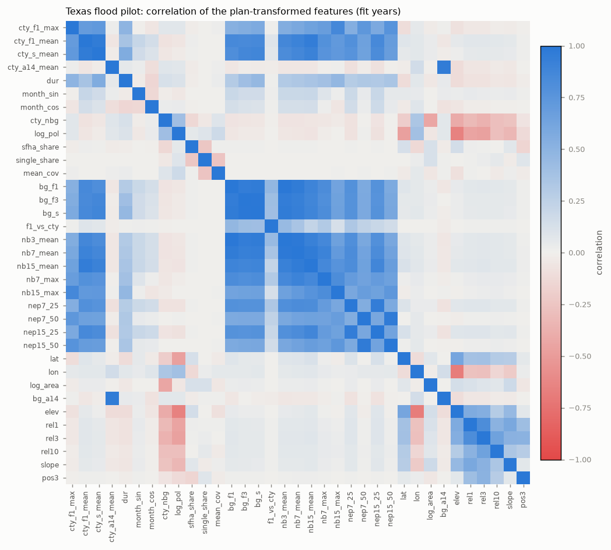

**Verdict.** There **is** regressable signal. Within the episode, 17 of 27 cell-level features are established, 14 of them with at least a small effect (AUC beyond 0.556 or below 0.444; the rest exist statistically but are negligible) (strongest: `bg_s` 0.726, `bg_f3` 0.725, `bg_f1` 0.725, `f1_vs_cty` 0.725), and 29 of 34 features are established as episode-level effects. No evidence for: `lat`, `lon`, `elev`, `rel1`, `pos3`, `slope`. The rain features are nearly collinear (20 pairs with |r| >= 0.9, variance inflation up to 184), so several of them are one piece of information measured repeatedly: the AUC of any one is the signal, and a linear model cannot separate their coefficients. Events per variable is not the limit; collinearity and the weak incremental information of the extra features are, consistent with stage 8 (only exposure and the cell's own rain add skill).

### 4.2 SCS3 event occurrence on the convective environment

Inputs are the anomaly-scaled tier C columns (28). Statistic: AUC among county-days of the same year (so a year-level difference cannot masquerade as signal); clusters: years (23). Positives: y0 6,707 fit / 2,442 test; y10k 824 / 288. Events per variable in the fit years: 29 (y10k).

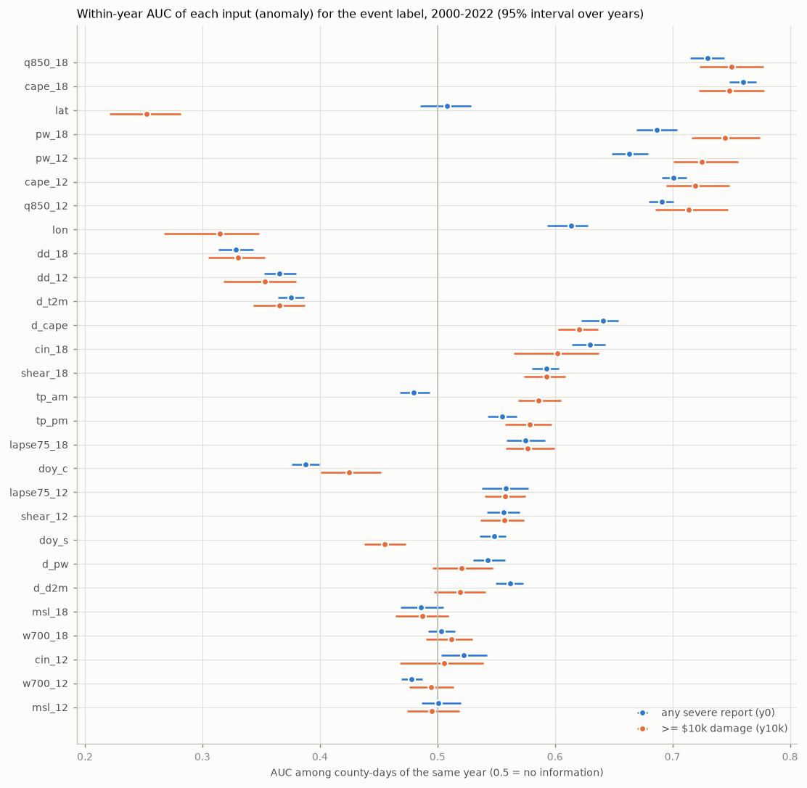

| Input | y0: AUC all years [95% CI] | y0 verdict | y10k: AUC all years [95% CI] | y10k verdict |
|---|---|---|---|---|
| `doy_s` | +0.548 [+0.536, +0.558] | established | +0.455 [+0.438, +0.473] | established |
| `doy_c` | +0.388 [+0.376, +0.400] | established | +0.424 [+0.401, +0.452] | present, not stable |
| `lat` | +0.508 [+0.485, +0.529] | not established | +0.253 [+0.221, +0.281] | established |
| `lon` | +0.614 [+0.593, +0.628] | established | +0.315 [+0.268, +0.348] | established |
| `cape_12` | +0.701 [+0.691, +0.712] | established | +0.719 [+0.695, +0.749] | established |
| `cin_12` | +0.522 [+0.503, +0.542] | present, not stable | +0.506 [+0.468, +0.539] | not established |
| `dd_12` | +0.365 [+0.353, +0.379] | established | +0.353 [+0.318, +0.380] | established |
| `pw_12` | +0.663 [+0.648, +0.679] | established | +0.725 [+0.701, +0.756] | established |
| `q850_12` | +0.691 [+0.680, +0.701] | established | +0.714 [+0.685, +0.747] | established |
| `lapse75_12` | +0.558 [+0.538, +0.577] | established | +0.558 [+0.540, +0.575] | present, not stable |
| `shear_12` | +0.556 [+0.542, +0.570] | established | +0.557 [+0.536, +0.573] | established |
| `w700_12` | +0.478 [+0.469, +0.487] | present, not stable | +0.494 [+0.476, +0.514] | not established |
| `msl_12` | +0.501 [+0.487, +0.520] | not established | +0.495 [+0.474, +0.519] | not established |
| `cape_18` | +0.760 [+0.748, +0.771] | established | +0.748 [+0.722, +0.778] | established |
| `cin_18` | +0.630 [+0.614, +0.643] | established | +0.602 [+0.565, +0.637] | established |
| `dd_18` | +0.329 [+0.314, +0.343] | established | +0.330 [+0.305, +0.353] | established |
| `pw_18` | +0.686 [+0.669, +0.704] | established | +0.745 [+0.716, +0.774] | established |
| `q850_18` | +0.730 [+0.715, +0.744] | established | +0.750 [+0.723, +0.777] | established |
| `lapse75_18` | +0.575 [+0.558, +0.592] | established | +0.577 [+0.558, +0.599] | established |
| `shear_18` | +0.593 [+0.581, +0.604] | established | +0.593 [+0.574, +0.609] | established |
| `w700_18` | +0.503 [+0.492, +0.515] | not established | +0.512 [+0.490, +0.530] | not established |
| `msl_18` | +0.486 [+0.468, +0.505] | not established | +0.487 [+0.464, +0.509] | not established |
| `d_cape` | +0.641 [+0.622, +0.654] | established | +0.620 [+0.603, +0.636] | established |
| `d_t2m` | +0.375 [+0.364, +0.387] | established | +0.365 [+0.344, +0.387] | established |
| `d_d2m` | +0.562 [+0.549, +0.573] | established | +0.519 [+0.497, +0.541] | not established |
| `d_pw` | +0.542 [+0.530, +0.557] | established | +0.521 [+0.496, +0.547] | not established |
| `tp_am` | +0.480 [+0.468, +0.493] | present, not stable | +0.586 [+0.568, +0.605] | established |
| `tp_pm` | +0.555 [+0.543, +0.567] | established | +0.579 [+0.558, +0.597] | established |

Collinearity (fit years, 291,312 rows): condition number 2.69e+06. The variance inflation factors are not meaningful here (up to 4.8e+13): the correlation matrix has 2 zero eigenvalues, i.e. **exact linear dependencies by construction**:

- exact dependence (eigenvalue 7.9e-15): `d_d2m` -0.25, `d_pw` +0.16, `d_t2m` +0.28, `dd_12` +0.41, `dd_18` -0.57, `pw_12` +0.41, `pw_18` -0.41
- exact dependence (eigenvalue 2.8e-14): `d_d2m` +0.19, `d_pw` +0.21, `d_t2m` -0.21, `dd_12` -0.31, `dd_18` +0.44, `pw_12` +0.54, `pw_18` -0.54
- near dependence (eigenvalue 0.042): `lapse75_12` -0.18, `lapse75_18` +0.18, `msl_12` -0.65, `msl_18` +0.66, `q850_18` -0.20

Reading: `dd` = 2 m temperature minus dew point, so `dd_18 - dd_12 = d_t2m - d_d2m`; `d_pw = pw_18 - pw_12`. The `d_*` columns repeat information that is already in the 12Z and 18Z columns. Trees are not affected. A linear learner cannot identify the coefficients of these groups (drop one column per dependency, or use a penalty and read only the combination), and in K-means the same physical quantity enters the distance two or three times, which up-weights it.

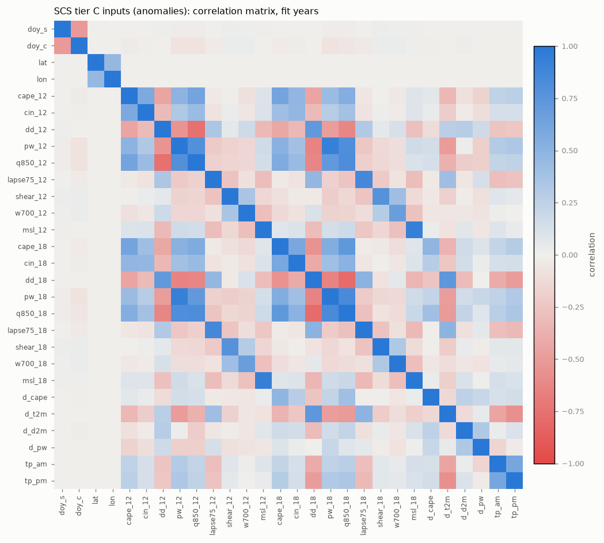

**Verdict.** There **is** regressable signal: 21 of 28 inputs are established for y0 and 19 for y10k (strongest for y10k: `q850_18` 0.750, `cape_18` 0.748, `lat` 0.253, `pw_18` 0.745). No evidence for any head for: `msl_12`, `w700_18`, `msl_18`. The AUCs below 0.5 mean a negative association (for example the dew-point depression). Univariate AUCs up to 0.76 sit next to models that reach only a few percent of Brier skill (stage 2: 0.03-0.04), because the events are rare (2.3% of county-days for y0): the discrimination exists, the calibrated gain is small.

### 4.3 New NFIP purchases on claim intensity and economic covariates

45 counties x 48 quarters = 2,160 county-quarters. Target: log((N + 0.5) / mean stock): new purchases per insured policy, county-quarter, two-way demeaned (county, season). Features are county- and season-demeaned the same way; statistic: Spearman correlation, clusters: counties; the 'first / second half' columns split the quarters at the middle (2012-2017 / 2018-2023).

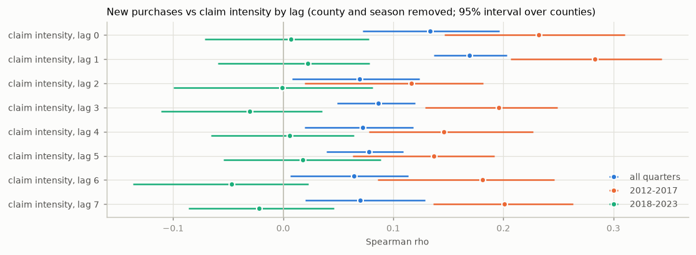

| Feature | rho all quarters [95% CI] | First half | Second half | Size | Verdict |
|---|---|---|---|---|---|
| claim intensity, lag 0 | +0.134 [+0.072, +0.196] | +0.232 | +0.007 | moderate | present, not stable |
| claim intensity, lag 1 | +0.169 [+0.137, +0.203] | +0.283 | +0.022 | moderate | present, not stable |
| claim intensity, lag 2 | +0.070 [+0.008, +0.124] | +0.116 | -0.001 | small | present, not stable |
| claim intensity, lag 3 | +0.087 [+0.049, +0.120] | +0.196 | -0.030 | small | present, not stable |
| claim intensity, lag 4 | +0.072 [+0.019, +0.118] | +0.146 | +0.006 | small | present, not stable |
| claim intensity, lag 5 | +0.078 [+0.039, +0.109] | +0.137 | +0.018 | small | present, not stable |
| claim intensity, lag 6 | +0.064 [+0.007, +0.113] | +0.181 | -0.047 | small | present, not stable |
| claim intensity, lag 7 | +0.070 [+0.020, +0.129] | +0.201 | -0.022 | small | present, not stable |
| d_mortgage_rate_4q (lag 1) | -0.120 [-0.153, -0.087] | +0.010 | -0.198 | moderate | present, not stable |
| d_log_home_value_4q (lag 1) | -0.115 [-0.198, -0.015] | -0.056 | -0.083 | moderate | present, not stable |
| log_permits_prev_year (lag 1) | -0.180 [-0.338, -0.053] | +0.113 | -0.210 | moderate | present, not stable |
| log_avg_premium (lag 1) | -0.350 [-0.430, -0.284] | -0.016 | -0.516 | large | present, not stable |
| log_homes_sold (lag 0) | -0.202 [-0.329, -0.081] | -0.020 | -0.174 | moderate | present, not stable |

Collinearity of the covariates: condition number 2.8, largest variance inflation 2.17: the lags and economic series are not collinear.

**Verdict.** **Present but not stable.** Claim intensity is positively associated with purchases at every lag (rho +0.06 to +0.17; every interval excludes 0), strongest at lags 0-1 (+0.13, +0.17). In the first half it reaches +0.28; in the second half it lies between -0.05 and +0.02. The first half contains Hurricane Harvey (2017), so the signal rests largely on one event, which limits how far the pulse kernel can be trusted. Economic covariates: 5 of 5 have an all-quarter interval that excludes 0 (d_mortgage_rate_4q -0.12, d_log_home_value_4q -0.11, log_permits_prev_year -0.18, log_avg_premium -0.35, log_homes_sold -0.20), but the interval excludes 0 in both halves for 0 of them (sign changes: d_mortgage_rate_4q, log_permits_prev_year), in line with stage 10's 'the economic cycle adds nothing stable'. The sample is small (45 counties) and quarters within a county are autocorrelated, so these intervals understate the uncertainty.

### 4.4 Damage ratio on water depth and building attributes

130,265 single-family claims 2016+ with exterior depth, coverage and damage amount; 2,063 state-months as clusters. Target: log(building damage / building coverage), clipped to [1e-4, 1.5]; claims 2016+ with exterior depth > 0.

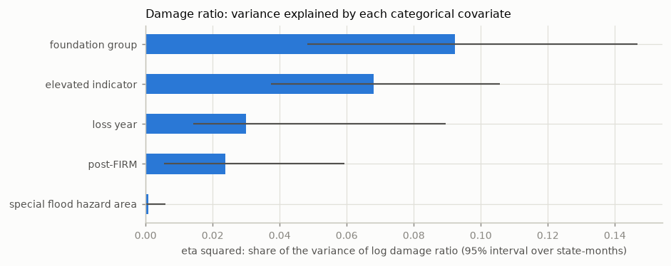

| Covariate | Statistic | Value [95% CI] | Verdict |
|---|---|---|---|
| log exterior depth | Spearman rho, all rows | +0.273 [+0.224, +0.334] | established |
| log exterior depth | Spearman rho within state-month | +0.298 [+0.231, +0.372] | established |
| elevated indicator | eta squared | 0.0680 [0.0375, 0.1056] | established |
| foundation group | eta squared | 0.0923 [0.0483, 0.1468] | established |
| loss year | eta squared | 0.0299 [0.0142, 0.0895] | established |
| post-FIRM | eta squared | 0.0237 [0.0056, 0.0594] | established |
| special flood hazard area | eta squared | 0.0008 [0.0000, 0.0059] | not established |
| occupancy (1 vs 11) | eta squared | not testable | the sample holds 1 occupancy category: from 2016 the foundation code is known for every occupancy-11 claim and for no occupancy-1 claim (checked on the clean claims table), so requiring a known foundation leaves only code 11 |

Share of claims with a known foundation code, by loss year and occupancy code (claims per cell in brackets):

| Loss year | 2010 | 2011 | 2012 | 2013 | 2014 | 2015 | 2016 | 2017 | 2018 | 2019 | 2020 | 2021 | 2022 | 2023 |
|---|---|---|---|---|---|---|---|---|---|---|---|---|---|---|
| occupancy 1 | 0% (28,294) | 0% (65,936) | 0% (105,931) | 0% (16,151) | 0% (12,011) | 0% (21,764) | 0% (44,957) | 0% (66,246) | 0% (18,380) | 0% (14,991) | 0% (10,300) | 0% (9,328) | 0% (1,942) | 0% (26) |
| occupancy 11 | 100% (2,583) | 100% (12,183) | 100% (37,474) | 100% (3,445) | 100% (3,150) | 100% (7,246) | 100% (28,869) | 100% (56,829) | 100% (17,657) | 100% (14,352) | 100% (16,835) | 100% (27,687) | 100% (41,476) | 100% (16,598) |

**A known foundation and the occupancy-code family are the same information in the claims file.** In the raw data every claim with a legacy occupancy code (1, 2, 3, 4, 6) has foundation '0' and every claim with a two-digit code (11, 12, 15, 16, 18) has a known foundation (checked year by year for codes 1 and 11: every loss year 2000-2023; `docs/CLEANING_REGISTER.md`, rule C10). The foundation comparisons (slab / basement / crawlspace / elevated) are therefore comparisons among two-digit-coded claims, and 'unknown vs known' contrasts elsewhere in the project are contrasts between code families.

Collinearity of the design (depth, foundation dummies, SFHA, post-FIRM, elevated): condition number 3.0, variance inflation crawl 1.21, elevated 2.44, log_depth 1.13, post_firm 1.1, sfha 1.11, slab 2.43.

**Verdict.** There **is** regressable signal in depth (rho +0.30 inside a state-month, so it is not an artefact of events being deeper on average) and in the foundation group (eta squared 0.092) and the elevated indicator (0.068). The special flood hazard area adds 0.0008 on its own: its information is carried by the other attributes. Each categorical covariate explains under 9% of the variance, so the claim is 'a regressable component exists', not 'the damage ratio is predictable'. The foundation dummies and the elevated indicator are partly collinear (variance inflation 2.43 for slab, 2.44 for elevated): tolerable, but their separate coefficients are less sharp than their joint effect.

### 4.5 Relationships not claimed, or not established

- **Post-event-buyer share vs Harvey claim rate** (stage 10): reported as a candidate whose interval contains 0; not recomputed here, and not claimed.
- **Wavelet scale features, neighbourhood smoothing, terrain** (stages 3, 8): no gain beyond the interval in the models; in the covariate view above the terrain columns have within-event AUCs of 0.46-0.55.
- **Longitude, latitude, elevation, slope** for flood occurrence: no within-event evidence (section 4.1).

## 5. What this report does not show

- It describes association in the available samples; it does not show causality or out-of-time forecast skill (that is `RESULTS.md`).
- Section 3 clusters the anomaly-scaled inputs of the project's pipeline; clustering the raw physical values would give a different (and more seasonal) partition.
- The cluster and regression sections use the 2000-2022 SCS record and the 2010-2023 pilot; a different period could move individual intervals.
- Only 45 counties enter the stock-flow statistics; the effective sample is smaller than the 2,160 county-quarters because quarters within a county are dependent.
- Hopkins statistic and silhouette depend on the scale of the inputs (anomalies divided by their standard deviation here).
- The OpenFEMA FAQ was not retrievable as a file (see the cleaning register); the raw checks above rely on the data dictionary and the row counts.
